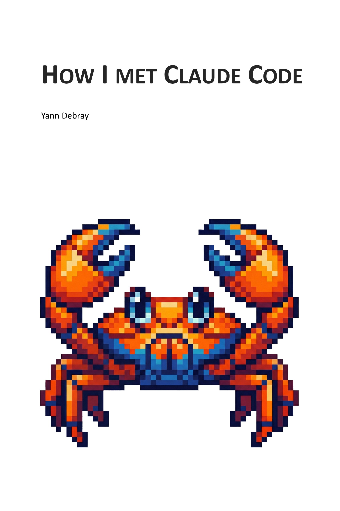
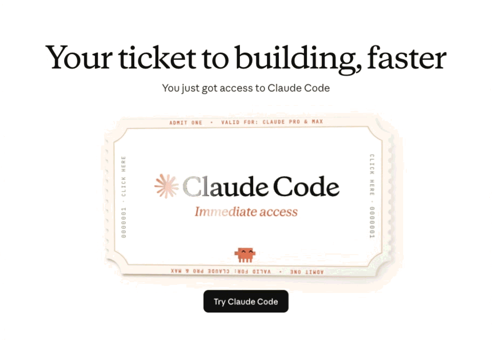

<p align="center">
  
</p>

<h1 align="center">How I Met Claude Code</h1>

<p align="center">
  <strong>A memoir about what happens when AI becomes a thinking partner</strong><br/>
  <em>by Yann Debray</em>
</p>

<p align="center">
  <a href="https://github.com/yanndebray/claude-code-book/releases/tag/v0.1">
    
  </a>
  <a href="LICENSE">
    
  </a>
  <a href="https://github.com/yanndebray/claude-code-book/releases/tag/v0.1">
    
  </a>
</p>

---

> *"There's BC — Before ChatGPT. There's BCC — Before Claude Code. And now there's whatever comes next."*

---

## About the Book

In the twilight of the ChatGPT era, a product manager was given access to a pilot program for Claude Code. What was meant to be a three-month evaluation turned into a book — and a transformation in how he understood the relationship between humans and artificial intelligence.

From strategic memos sharpened through intellectual sparring, to CLI tools named after philosophers like Nietzsche and Montaigne, to competitive intelligence that collapsed weeks of research into hours — this memoir traces the arc from curious skeptic to committed collaborator.

Along the way, it confronts the real tensions: the colleague whose six months of work was replicated in thirty minutes, the governance gray areas no one has answers to, and the uncomfortable question of what remains distinctly human when intelligence becomes cheap.

## Chapters

| # | Title | Theme |
|---|-------|-------|
| 0 | **Introduction** | Setting the stage |
| 1 | **Before Claude Code (BCC)** | The ChatGPT era, vibe coding origins |
| 2 | **First Contact** | December 2025, the MathWorks pilot begins |
| 3 | **The Philosopher Tools** | Nietzsche, Montaigne, Ricoeur — CLI tools as intellectual companions |
| 4 | **The Competitive Intelligence Machine** | Weeks of research collapsed into hours |
| 5 | **The MCP Revolution** | Model Context Protocol and MATLAB integration |
| 6 | **The Side Projects That Kept Growing** | recettesdezoe.com, GhostRunners, sports analytics |
| 7 | **Writing the Future** | "The Age of AI Agents" — writing a book about the future with AI |
| 8 | **What This Relationship Actually Is** | Five modes of collaboration, identity shifts |
| | **Appendix** | Key links and references |

## Five Modes of Human-AI Collaboration

The book identifies five distinct modes that emerged from three months of working with Claude Code:

1. **The Strategic Sparring Partner** — sharpening memos and competitive analysis
2. **The Research Accelerator** — collapsing weeks of intelligence work into hours
3. **The Creative Collaborator** — building philosopher tools and side projects
4. **The Technical Translator** — bridging product thinking and engineering
5. **The Thinking Partner** — the mode that changed everything

## About the Author

**Yann Debray** is a product manager at MathWorks (developers of MATLAB) based in Boston. He participated in an internal pilot program to assess Claude Code for non-developers in Q1 2026. What started as a three-month evaluation became this book.

He builds things at the intersection of technical computing and AI — from the MATLAB MCP Server to a sports analytics YouTube channel ([@yannspeaksai](https://youtube.com/@yannspeaksai)).

## Repository Structure

```
claude-code-book/
├── chapters/          ← One Markdown file per chapter (source of truth)
├── cover/             ← Book cover assets and KDP paperback files
├── notes/             ← Source material, outlines, and writing workflow
├── scripts/           ← Preprocessing utilities
├── CLAUDE.md          ← Instructions for AI collaboration on this project
└── README.md          ← You are here
```

## Get the Book

The v0.1 manuscript is available as a [**GitHub Release**](https://github.com/yanndebray/claude-code-book/releases/tag/v0.1) in PDF and DOCX formats.


A license of Claude Code is not contained with this book.

Get your own: [https://claude.com/product/claude-code](https://claude.com/product/claude-code)



## License

This project is licensed under the [MIT License](LICENSE).

---

<p align="center">
  <em>Written by a human, with a thinking partner.</em>
</p>
